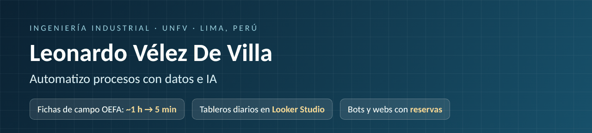
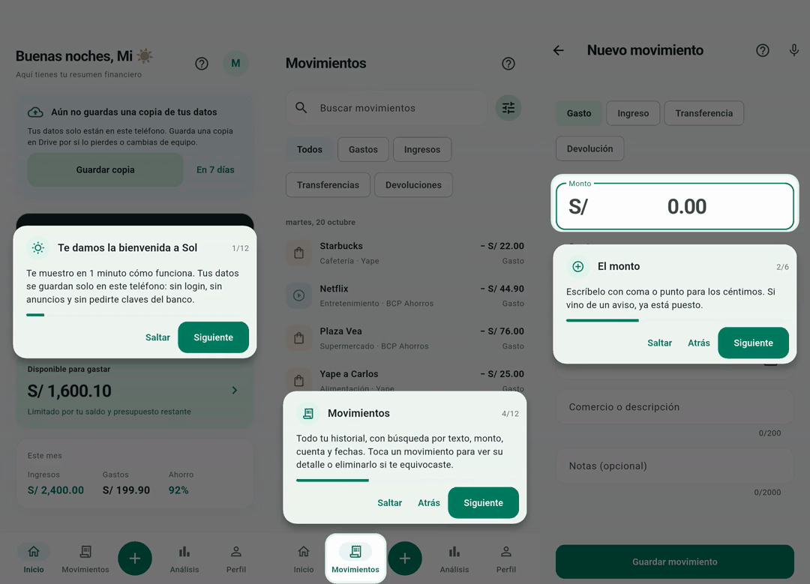

  
  
  

Estudiante de último ciclo de **Ingeniería Industrial** (UNFV, décimo superior; egreso dic. 2026). Tomo un proceso manual, lo convierto en una herramienta digital con IA, mido el resultado y lo dejo documentado para que el equipo lo use solo.

**Ahora:** practicante de automatización y datos en la OEFA. 
**Busco:** puestos de automatización, procesos o datos desde diciembre de 2026, en Lima o remoto.

---

## 📈 Resultados

| Logro | Detalle |
|---|---|
| ⏱️ **De ~1 hora a 5 minutos** | Revisión de cada ficha de supervisión de campo en la OEFA (‑92 %), medida en más de 230 fichas reales. |
| 📊 **Tablero que se actualiza solo** | Apps Script descarga cada día los registros del SIGED, los consolida en Google Sheets y alimenta un tablero en Looker Studio por zona. |
| 🔔 **Plazos sin seguimiento manual** | Sincronización con el sistema INAF, cálculo de plazos en días hábiles y alertas por correo. |
| 🧑‍🏫 **Adopción** | Capacité a los locadores de campo y elaboré manuales y videotutoriales para el personal. |

---

## 🧩 Proyectos

| Proyecto | Qué resuelve | Hecho con |
|---|---|---|
| 🗺️ **[Fichas de campo · OEFA](https://github.com/leonardovelezdevilla/caso-fichas-de-campo)**  Caso de estudio · código institucional | Dos apps web que funcionan sin internet, validan coordenadas contra capas de SERNANP, ANA y Cultura, y envían cada ficha a un panel de revisión. | Apps Script · JavaScript · PWA · Leaflet |
| 🎥 **[Atisba](https://github.com/leonardovelezdevilla/caso-atisba)**  Caso de estudio · prototipo | Lectura de placas y alertas sobre las cámaras que ya existen, con un asistente en español de IA local. 808 pruebas y 43 decisiones de arquitectura. | Visión por computadora · IA local (Ollama) |
| 🌐 **[Webs para negocios](https://velezdevilla.com)**  En producción | Webs con reservas en línea, pagos y recordatorios por WhatsApp para veterinarias, barberías, consultorios y spas, con demos que se pueden probar. | Astro · Vercel |
| ⚽ **Bot de WhatsApp para una escuela de fútbol**  Privado · demo disponible | Inscripciones, pagos y recordatorios de tres sedes por WhatsApp, más un panel para personal no técnico. 259 pruebas automatizadas. | WhatsApp Business API · Cloudflare Workers · D1 (SQL) |
| 💰 **Sol · finanzas personales**  Privado | App Android que registra gastos e ingresos automáticamente leyendo los avisos de Yape y del banco, con presupuestos, metas y exportación a Excel. | Flutter · SQLite · GitHub Actions |
| 💜 **[VitaRing](https://github.com/leonardovelezdevilla/vitaring)**  Proyecto universitario | Apps Android y Wear OS que leen el pulso del reloj y lo muestran con un semáforo. | Android · Wear OS · GitHub Actions |

---

## 🛠️ Herramientas

**Automatización y datos** 

**IA** 

**Desarrollo** 

**Métodos:** Six Sigma (DMAIC) · Scrum y Kanban · levantamiento y mapeo de procesos · pruebas antes de cada despliegue

📍 Lima, Perú
